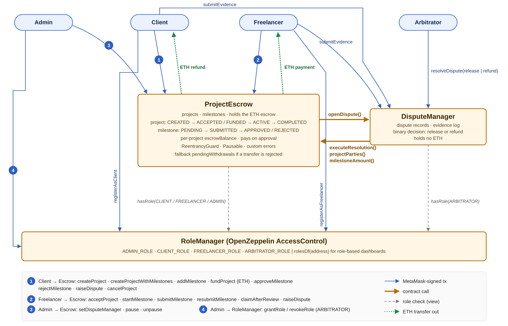
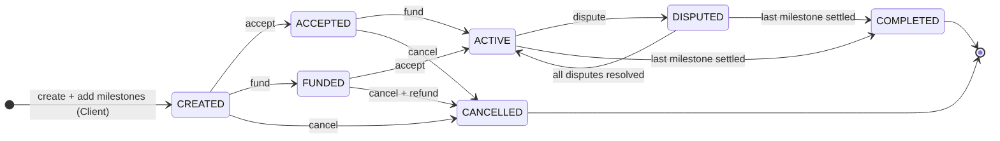
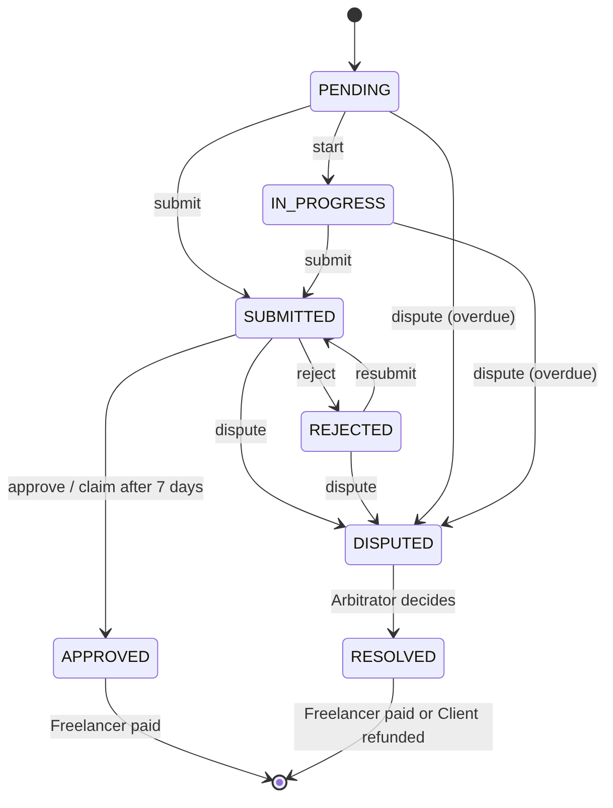
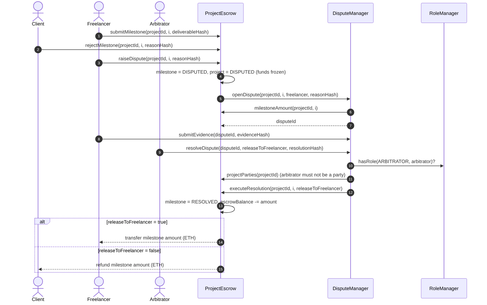

# Smart Contract Design, Security and Testing

## 1. Overview

The on-chain layer implements the trust-sensitive part of the Freelancer Milestone Payment DApp: the escrow,
the milestone payment rules and the dispute decision. Following the hybrid design in the requirements (§17.4),
only financial state and critical events live on-chain. Titles, descriptions, rejection reasons, dispute
explanations and files are kept by the backend, and only their `bytes32` hash is recorded on-chain so later
tampering can be detected (§13–14, SR-07).

The logic is split into three Solidity 0.8.24 contracts built on OpenZeppelin Contracts 5.4.0 (Figure 1).
Payments use native test ETH, as in the requirements' example (§5.2).

| Contract | Responsibility | Holds ETH? |
|---|---|---|
| `RoleManager` | Single source of truth for roles (OpenZeppelin `AccessControl`): Admin, Client, Freelancer, Arbitrator | No |
| `ProjectEscrow` | Projects, milestones, the ETH escrow, approval / rejection / resubmission, payment release | **Yes** |
| `DisputeManager` | Dispute records, evidence log, the Arbitrator's binary decision | No |

*Figure 1. Smart contract interaction diagram. Blue arrows are MetaMask-signed user transactions, orange arrows
are contract-to-contract calls, grey dashed arrows are role checks, green dotted arrows are ETH paid out.*

### 1.1 How the contracts interact

- **ProjectEscrow → DisputeManager.** `raiseDispute` freezes the milestone and calls `openDispute`, which records
  the dispute and the amount at stake.
- **DisputeManager → ProjectEscrow.** When the Arbitrator decides, `resolveDispute` calls back
  `executeResolution`, which only the DisputeManager address may call. The DisputeManager also reads
  `projectParties` (to stop a party from deciding their own case) and `milestoneAmount`.
- **Both → RoleManager.** Every restricted function checks `RoleManager.hasRole(...)`, so revoking a role in one
  place takes effect in both contracts in the same block.

The DisputeManager needs the escrow's address in its constructor, and the escrow needs the DisputeManager's
address, so the escrow has a one-time `setDisputeManager`. It reverts if called again, so the link cannot later be
redirected to a malicious contract.

## 2. Roles and access control

The brief requires at least three roles; the requirements define Client, Freelancer and Arbitrator (§4), and the
contracts add an Admin to authorise Arbitrators.

| Role | How obtained | What it can do on-chain |
|---|---|---|
| **Client** | `registerAsClient()` from their own wallet | Create projects and milestones, fund, cancel before work starts, approve or reject submissions, raise disputes |
| **Freelancer** | `registerAsFreelancer()` | Accept assigned projects, start, submit and resubmit milestones, claim after the review period, raise disputes |
| **Arbitrator** | Granted by the Admin only | Resolve open disputes by releasing to the Freelancer or refunding the Client. Cannot withdraw funds (§4.3) |
| **Admin** | Deployer wallet | Grant or revoke roles, connect the DisputeManager once, pause and unpause new activity |

Role membership alone is not enough. The contracts also check ownership of each project:

- Only the project's own Client may fund, approve or reject (BR-01, BR-08). Holding CLIENT_ROLE does not let one
  client touch another client's project.
- Only the assigned Freelancer may accept or submit (BR-04, BR-06), and the assigned wallet must hold FREELANCER_ROLE.
- A Client cannot assign themselves as Freelancer.
- An Arbitrator must hold ARBITRATOR_ROLE when deciding and cannot be the Client or Freelancer of that project
  (BR-12, SR-03). An Arbitrator wallet cannot register as Client or Freelancer.

## 3. Transaction logic

### 3.1 Transaction types

The brief requires at least ten blockchain transaction types. The contracts provide 19 state-changing
transactions. Scenario A and Scenario B from the requirements (§20) were run end-to-end on the local network: 18
transactions, logged with hashes in `deployments/localhost-demo-transactions.json`.

| # | Transaction | Contract | Caller | Gas (avg) |
|---|---|---|---|---:|
| 1 | `registerAsClient` | RoleManager | any wallet | 50,029 |
| 2 | `registerAsFreelancer` | RoleManager | any wallet | 50,052 |
| 3 | `grantRole` / `revokeRole` (Arbitrator) | RoleManager | Admin | 51,485 / 29,543 |
| 4 | `createProject` | ProjectEscrow | Client | 84,614 |
| 5 | `createProjectWithMilestones` | ProjectEscrow | Client | 173,214 |
| 6 | `addMilestone` | ProjectEscrow | Client | 74,775 |
| 7 | `acceptProject` | ProjectEscrow | Freelancer | 35,371 |
| 8 | `fundProject` (payable) | ProjectEscrow | Client | 39,712 |
| 9 | `cancelProject` | ProjectEscrow | Client | 42,922 |
| 10 | `startMilestone` | ProjectEscrow | Freelancer | 33,161 |
| 11 | `submitMilestone` | ProjectEscrow | Freelancer | 34,440 |
| 12 | `approveMilestone` (pays Freelancer) | ProjectEscrow | Client | 60,651 |
| 13 | `rejectMilestone` | ProjectEscrow | Client | 32,041 |
| 14 | `resubmitMilestone` | ProjectEscrow | Freelancer | 34,389 |
| 15 | `claimAfterReview` | ProjectEscrow | Freelancer | 54,292 |
| 16 | `raiseDispute` | ProjectEscrow → DisputeManager | Client / Freelancer | 116,478 |
| 17 | `submitEvidence` | DisputeManager | Client / Freelancer | 34,062 |
| 18 | `resolveDispute` | DisputeManager → ProjectEscrow | Arbitrator | 105,577 |
| 19 | `pause` / `unpause` / `setDisputeManager` / `withdraw` | ProjectEscrow | Admin / fallback | 33,220 / 33,201 / 50,921 / – |

*Average gas from `hardhat-gas-reporter` across the test suite (`reports/gas-report.txt`).*

### 3.2 Project and milestone state machines

Projects and milestones follow exactly the states in the requirements (§7, §8), shown in Figures 2 and 3. Every
function first checks the current state and reverts with `InvalidProjectStatus` or `InvalidMilestoneStatus`
otherwise (SR-05). This rules out paying a milestone twice (BR-09, SR-04), moving a finished milestone back
(BR-15), or adding milestones after the terms are agreed (BR-14).

*Figure 2. Project states. The normal path is CREATED → ACCEPTED → ACTIVE (accept, then fund). Funding first is
also accepted and waits in FUNDED until the Freelancer accepts; either way a project becomes ACTIVE only when it
is both accepted and fully funded (BR-05).*

*Figure 3. Milestone states. A rejection never refunds the Client (§5.3): the Freelancer resubmits or disputes.*

Key rules enforced in code:

- **Full funding (BR-03, §5.2).** Milestone amounts must add up exactly to the project total before the project can
  be accepted or funded, and `fundProject` requires `msg.value` to equal the total.
- **Exact payment (BR-10).** Approval transfers exactly the milestone's predefined amount.
- **Funds frozen during a dispute (BR-11).** A disputed milestone cannot be approved, resubmitted or cancelled until
  the Arbitrator decides. Other milestones of the same project continue normally; the project shows DISPUTED while
  at least one dispute is open.
- **No cancellation once work starts (BR-13).** `cancelProject` works only in CREATED, ACCEPTED or FUNDED, and
  refunds any deposit.

### 3.3 Decisions where the requirements are silent

| Situation | Decision in the contracts |
|---|---|
| Client never reviews a submission | After 7 days (`REVIEW_PERIOD`) the Freelancer can call `claimAfterReview` and is paid. This stops a Client from locking funds by staying silent |
| Freelancer misses a milestone's due date without submitting | The Client may raise a dispute on that milestone, and the Arbitrator decides |
| Who authorises Arbitrators | The Admin (deployer) wallet |
| Platform fee | None |

### 3.4 Dispute flow

Figure 4 shows Scenario B. The decision is binary, as the requirements specify (§5.4): the whole milestone amount
goes to the Freelancer or back to the Client. The DisputeManager holds no ETH and has no transfer function, so an
Arbitrator can choose only between the two parties and can never move funds anywhere else.

*Figure 4. Dispute resolution sequence (Scenario B).*

## 4. Security design

| Threat | Control in the contracts | Test evidence |
|---|---|---|
| Re-entrancy (SWC-107) | `nonReentrant` on every function that sends ETH; checks-effects-interactions: state, escrow balance and completion are updated before the transfer | A malicious freelancer wallet re-enters `approveMilestone` while being paid; the call fails with `ReentrancyGuardReentrantCall` and the other milestone is untouched |
| A recipient that rejects ETH blocks the workflow | Payment is pushed automatically (FR-10). If the transfer fails, the amount is credited to `pendingWithdrawals` and the recipient calls `withdraw()` later, so the project still completes | Test with a wallet contract that reverts on receive |
| Unauthorised actions (SR-01, SR-02, SR-03) | Central `RoleManager`; per-project ownership checks; `executeResolution` callable only by DisputeManager; `openDispute` only by the escrow | Negative tests for outsiders, the wrong party and revoked roles on every restricted function |
| Duplicate payment (BR-09, SR-04, NFR-02) | Milestone status changes to APPROVED or RESOLVED before paying; no path leads back | Double-approve, re-submit and re-dispute tests after payment |
| Paying more than was deposited (SR-06) | Per-project `escrowBalance`; `_release` reverts with `InsufficientEscrow` if it would go negative | Invariant test: escrow balance = sum of unsettled milestones after mixed approve and dispute flows |
| Arbitrator abuse | Arbitrator only picks release or refund; cannot be a party; cannot register as Client/Freelancer; must still hold the role when deciding | Party-as-arbitrator and revoked-arbitrator tests |
| Admin abuse | The Admin cannot move escrowed ETH, approve milestones or decide disputes; the DisputeManager link can be set only once | Wiring-once test |
| Emergency (bug discovered) | `Pausable` blocks new projects, milestones, acceptance and funding. Approvals, disputes, cancellation and withdrawal stay open so funds are never trapped | Pause test |
| Integer overflow (SWC-101) | Solidity ≥ 0.8 checked arithmetic; `unchecked` only where bounds are proven (counters, ≤ 20 milestones) | – |
| Unbounded loops (SWC-128) | At most 20 milestones per project | Over-limit test |
| Timestamp dependence (SWC-116) | Only day-scale due dates and the 7-day review period, where seconds of drift do not matter | Time-travel tests |
| Sensitive data on-chain (SR-07) | Only hashes of descriptions, reasons and files are recorded, in events | – |
| Meaningful errors (SR-08, NFR-06) | Custom errors with context, e.g. `IncorrectDeposit(sent, required)`, `InvalidMilestoneStatus(current)`, `ReviewPeriodActive(claimableAt)` | Every negative test checks the exact error |

Known limitations, for the evaluation section:

- The Admin is a single wallet. In production the Admin role should be a multisig (e.g. Safe).
- Arbitration is centralised to Admin-authorised arbitrators. Human judgement is still required, as the
  requirements note (§19.3).
- Native ETH is volatile (§19.7). The escrow could be switched to a stablecoin such as USDC for real payments.
- Contracts are not upgradeable, so users can verify the exact code holding their funds. Fixes would be deployed as a
  new version, with `pause` used to stop new projects on the old one.
- No external audit has been done. Static analysis with Slither is a recommended next step.

## 5. Gas optimisation

Gas is paid by the Client and Freelancer on every action, so gas efficiency matters (§19.5). Measured with
`scripts/gas-bench.js` (Hardhat network, optimizer 200 runs):

| Technique | Before | After | Saving |
|---|---:|---:|---:|
| Packing the `Project` struct into 3 storage slots (`uint40` timestamps, `uint8` counters, `uint96` amounts next to addresses) instead of 9 | 203,405 | 88,781 | **56.4 %** |
| Storing document hashes in events instead of contract storage | 44,205 | 23,434 | **47.0 %** |
| Custom errors instead of `require` strings (per failed call; also smaller bytecode) | 5,669 | 5,586 | 1.5 % |
| Manual `unchecked { ++i; }` loop increment vs `i++` | 26,190 | 26,188 | 0.0 % |

Other techniques used: the `Milestone` struct fits one slot (amount + due date + submission time + status);
the `Dispute` struct fits three; contract references are `immutable` and role identifiers `constant`; milestone
arrays are passed as `calldata`; `createProjectWithMilestones` creates a project with three milestones for 192,747
gas instead of 291,827 for `createProject` plus three `addMilestone` calls in the demo run (34 % less).

The loop result is a deliberate negative finding. Since Solidity 0.8.22 the compiler already removes the overflow
check from simple loop counters, so the manual `unchecked` increment no longer saves anything on this compiler.

Deployment of all three contracts plus wiring costs 4.15 M gas: about 0.0083 ETH at 2 gwei. A complete
three-milestone project (create with milestones, accept, fund, three submissions and three approvals) costs about
0.54 M gas across both parties, about 0.0011 ETH at 2 gwei. On an Ethereum L2 the same flow would cost cents.

## 6. Testing

Tests use Mocha/Chai with Hardhat Network helpers (fixtures and time travel) in `test/Escrow.test.js`. Test names
carry the requirement IDs they verify, so the results map directly to the success indicators in §18.

| Area | Tests | Requirements covered |
|---|---:|---|
| RoleManager | 3 | FR-02, SR-01: self-registration, admin-only arbitrators, revocation takes effect at once |
| Project setup | 7 | FR-03–FR-07, BR-01–BR-05, BR-13, BR-14: milestone totals, both funding orders, deposit amount, cancellation rules, input validation |
| Milestone workflow | 7 | FR-08–FR-12, BR-06–BR-10, BR-15, SR-02, SR-04, SR-05: Scenario A, exact payment, pay-once, reject and resubmit, review timeout |
| Disputes | 10 | FR-13, FR-14, BR-11, BR-12, SR-03: Scenario B, frozen funds, release and refund, evidence, overdue disputes, unauthorised resolvers, party-as-arbitrator |
| Security & admin | 5 | SR-06, NFR-02: rejected transfer fallback, re-entrancy attack, escrow balance invariant, pause, one-time wiring |
| **Total** | **32** | **32 passing** |

Coverage (`npx hardhat coverage`, test helpers excluded): **100 % statements, 100 % functions, 100 % lines,
81.5 % branches**. The uncovered branches are defensive checks that ordinary use cannot reach, such as the `uint96`
total-overflow guard and the `InsufficientEscrow` check, which the accounting makes impossible to trigger.

Mapping to the success indicators: SI-02 (payment accuracy) and SI-03 (no duplicate payment) are asserted by
balance checks in every payment test; SI-04 (access control) by the negative tests; SI-05 (traceability) by event
assertions; SI-01 and SI-06 by the Scenario A and B tests and the 18-transaction demo run.

## 7. Deployment

The contracts are deployed on a Hardhat local network (chain ID 31337) with `scripts/deploy.js`. The script
deploys, wires and records every address, transaction hash, block, gas figure and constructor argument in
`deployments/localhost.json`, and exports ABIs to `deployments/abi/` for the backend and frontend.

| Contract | Address (local, chain 31337) | Deploy gas |
|---|---|---:|
| RoleManager | `0x5FbDB2315678afecb367f032d93F642f64180aa3` | 587,311 |
| ProjectEscrow | `0xe7f1725E7734CE288F8367e1Bb143E90bb3F0512` | 2,714,228 |
| DisputeManager | `0x9fE46736679d2D9a65F0992F2272dE9f3c7fa6e0` | 801,651 |

The same script deploys to the Sepolia public testnet with `--network sepolia` once `SEPOLIA_RPC_URL` and
`PRIVATE_KEY` are set. The public addresses and Etherscan verification links are recorded in `docs/DEPLOYMENT.md`.
